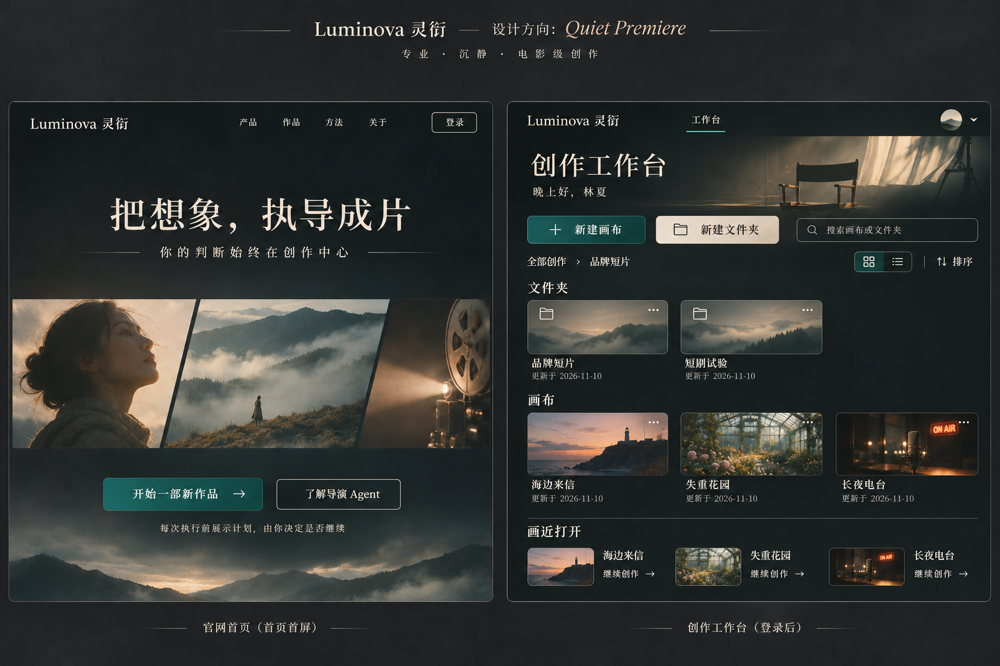

# Luminova 官网首页 UI 设计与实现说明

> 状态：已实现  
> 日期：2026-11-10  
> 设计方向：Quiet Premiere（静谧首映）

## 1. 设计目标

官网首页承担品牌表达、产品价值说明和登录转化，不承载工作台或画布业务状态。页面需要让专业创作者感受到：Luminova 是一套可控、克制、以创作者判断为中心的 AI 视频创作空间，而不是“一键生成”工具。

核心信息：

- 主张：把想象，执导成片。
- 原则：你的判断始终在创作中心。
- 安全感：每次执行前展示计划，由用户决定是否继续。
- 转化：开始一部新作品、了解导演 Agent、登录。

## 2. 视觉方向

采用“静谧首映”的电影编辑风格：大面积深色留白、衬线标题、低饱和电影画面、少量铜色标注和深青色操作按钮。避免传统 SaaS 仪表盘式的高密度卡片、炫光渐变和过度装饰。

### 2.1 色彩

| Token | 色值 | 用途 |
| --- | --- | --- |
| Obsidian | `#0D1014` | 主背景 |
| Fog | `#ECE8DE` | 主文字、浅色表面 |
| Bone | `#D8D3C8` | 次级标题、柔和文字 |
| Deep Teal | `#0F6B68` | 主操作、品牌功能色 |
| Teal Bright | `#187D78` | 悬浮与聚焦状态 |
| Copper | `#C4774A` | 标注、序号、强调细节 |

### 2.2 字体

- 标题与品牌：Noto Serif SC，500/600。
- 正文与控件：Noto Sans SC，400/500。
- 英文标注使用大写与较宽字距，形成电影制作标记的感觉。

## 3. 页面结构

1. 固定导航：品牌、产品、作品、方法、关于、登录。
2. 首屏主视觉：品牌主张、电影三联画、双 CTA、安全承诺。
3. 创作方法：先表达、再生成；Agent 提案、用户决定；从灵感走到成片。
4. 品牌声明：明确 Agent 与创作者的职责边界。
5. 页脚：品牌与产品定位。

## 4. 交互说明

- 导航项目平滑滚动到对应内容。
- “开始一部新作品”和“登录”打开认证提示层。
- 对话框支持点击遮罩关闭与 `Escape` 关闭。
- “了解导演 Agent”滚动到创作方法。
- 主视觉仅使用轻微缩放，按钮仅使用小幅位移，避免抢夺内容注意力。
- 尊重 `prefers-reduced-motion`。

## 5. 响应式策略

- 桌面端：导航居中，三联画横向完整展示，CTA 并排。
- 平板端：导航折叠为菜单，方法区由双栏转为单栏。
- 移动端：标题分两行，主视觉聚焦中间故事主体，CTA 纵向排列，正文保持可读宽度。

## 6. 与后端能力的边界

本阶段只实现官网首页。首页不伪造生产队列、素材库、协作或 Agent 执行进度。进入登录后的工作台后续只映射已经存在的能力：

- 创作条目：文件夹与画布。
- 列表、搜索、最近打开。
- 新建、重命名、移动、排序、删除与恢复。
- 用户资料与认证。

认证弹层目前是界面占位，待登录/注册路由接入时复用现有入口，不改变首页信息架构。

## 7. 技术实现

- React 19 + TypeScript。
- Vite 6。
- Phosphor Icons。
- 本地字体资源，避免运行时依赖外部字体 CDN。
- 独立工程目录：`luminova-frontend/`。

## 8. 设计图

说明：本轮已实现左侧官网首页方向；右侧工作台仅作为后续视觉方向，具体功能必须继续以现有 CreativeEntry 接口为准。画布页面暂不设计。

## 9. 验收结论

- 生产构建通过。
- TypeScript 类型检查通过。
- Sites 静态资源与 SPA 回退测试 4/4 通过。
- Chrome 1440 × 1100 与 390 × 844 视觉验收通过。
- Design QA：passed。
